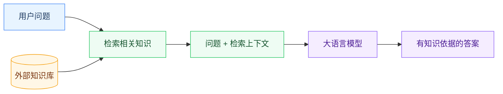
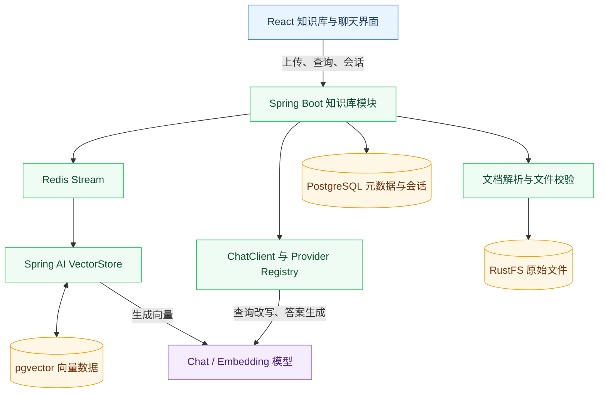
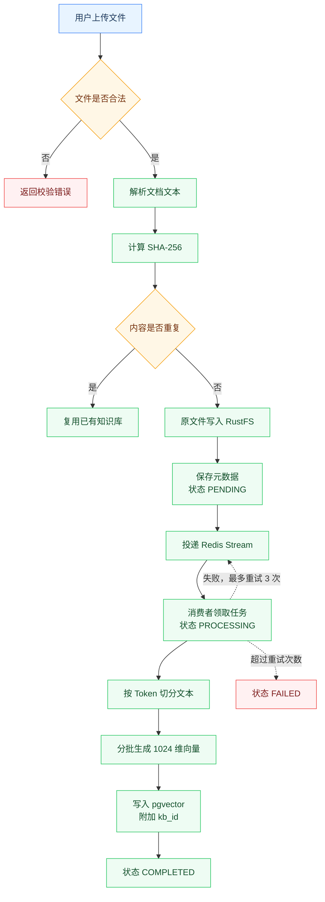
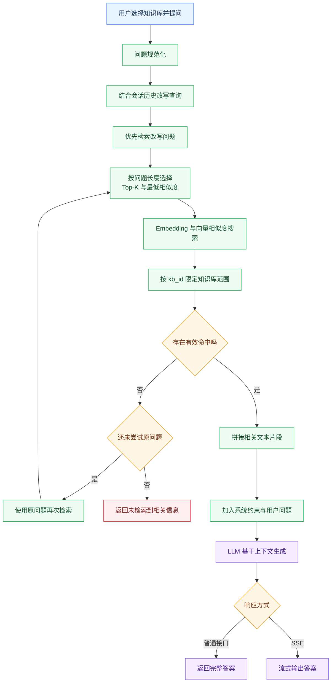
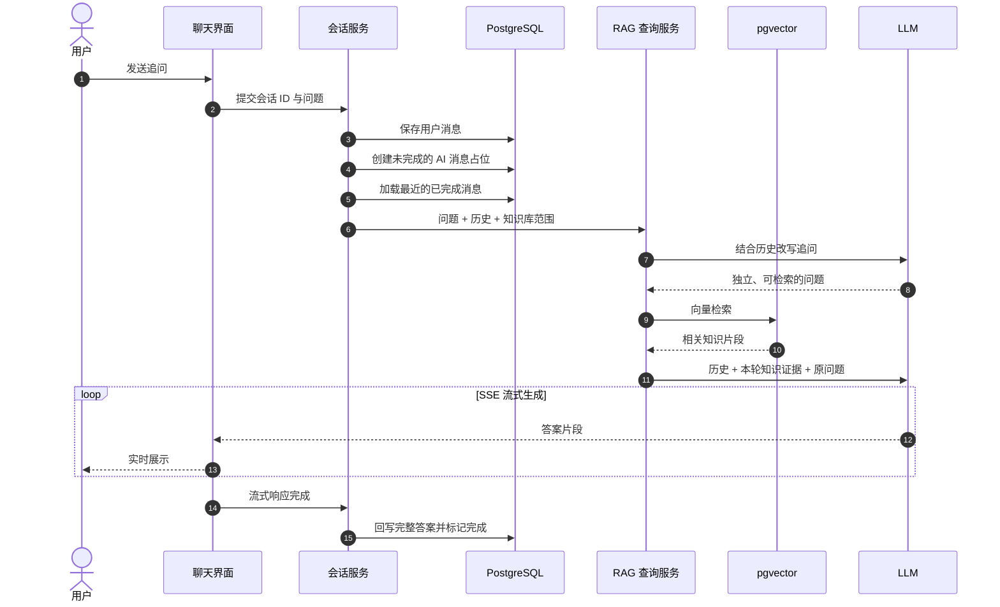
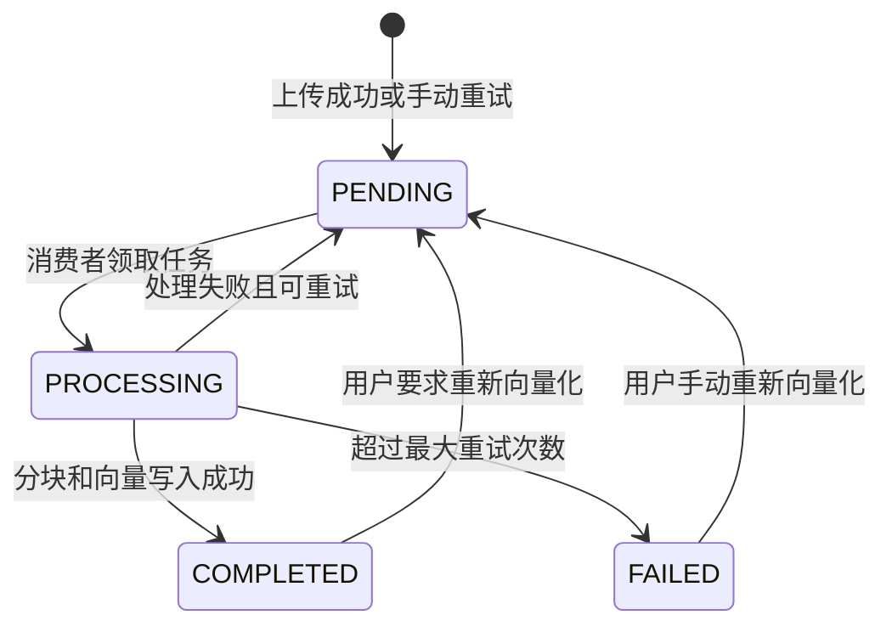

# RAG 知识库技术实现复盘

## 1. RAG 是什么

RAG 将大语言模型的“语言生成能力”和外部知识库的“事实检索能力”组合起来。模型回答问题前，先从指定知识库中召回相关内容，再把这些内容作为上下文交给模型生成答案。

传统大模型主要依赖训练阶段学到的参数知识，容易遇到知识过期、企业私有知识不可见、回答缺少依据等问题。RAG 不要求重新训练模型，而是在推理阶段动态注入最新或私有资料，因此更适合面试资料、项目文档、内部规范等场景。

一次完整的 RAG 问答可以抽象为：

1. 用户选择一个或多个知识库并提出问题。
2. 系统对问题进行清洗、必要时结合历史对话改写。
3. 将问题转换为向量，在向量库中检索语义相近的文本片段。
4. 对检索结果进行知识库范围过滤、相似度阈值过滤和数量控制。
5. 把命中文本拼装为上下文，连同问题和对话历史提交给大语言模型。
6. 模型只依据检索上下文生成回答；没有有效命中时明确返回“知识库中没有相关信息”。

下面这张图体现了 RAG 与“直接向大模型提问”的核心区别：模型回答前多了一次知识检索，最终答案因此受到外部资料约束。



## 3. 项目的总体架构

项目里采用“文件存储、关系型元数据、向量检索、LLM 生成”分离的架构：

| 层次 | 主要职责 | 本项目实现 |
| --- | --- | --- |
| 文件层 | 保存原始文件，支持重新解析和下载 | RustFS（S3 兼容对象存储） |
| 元数据层 | 保存名称、分类、哈希、状态、统计信息 | PostgreSQL + JPA |
| 向量层 | 保存文本片段、Embedding 和 metadata | Spring AI PgVectorStore + pgvector |
| 异步层 | 解耦上传请求与向量化耗时任务 | Redis Stream |
| 生成层 | 查询改写、答案生成、流式输出 | Spring AI ChatClient + LLM Provider Registry |
| 会话层 | 保存会话、消息和关联知识库 | PostgreSQL |

### 3.1 系统组件关系



整体链路为：

```text
上传文件
  -> 文件校验、内容解析、SHA-256 去重
  -> 原文件写入 RustFS，元数据写入 PostgreSQL
  -> Redis Stream 投递向量化任务
  -> 文本切分、Embedding、写入 pgvector
  -> 用户选择知识库并提问
  -> 查询改写与动态检索
  -> 拼接上下文，调用 LLM
  -> 普通响应或 SSE 流式响应
```

## 4. 知识库构建链路

知识库构建属于 RAG 的离线阶段，目标是把不同格式的原始文件加工成可以按语义检索的文本向量。



### 4.1 文件接入与内容解析

知识库支持 PDF、DOC、DOCX、TXT、Markdown 等文档类型。上传时先校验大小和 MIME 类型，再通过统一文档解析能力提取纯文本。解析失败或无法提取有效文本时不会进入向量化流程。

原始文件保存在 RustFS，数据库只保存文件名、类型、大小、存储 Key、访问地址等元数据。这样既保留了原始资料，也避免把大段原文直接放进业务表。

### 4.2 内容去重

系统以文件内容的 SHA-256 作为唯一指纹。相同内容再次上传时直接复用已有知识库，并增加访问计数，不重复保存文件和向量。这可以降低存储成本，也避免同一文档在检索结果中重复出现。

需要注意的是，当前去重粒度是“整个文件内容”。如果文件只修改一小段，仍会被视为新文件并重新建立向量索引。

### 4.3 元数据与状态管理

知识库实体记录向量化状态：`PENDING`、`PROCESSING`、`COMPLETED`、`FAILED`。上传接口返回后，前端可以通过列表或详情接口查询状态，而不必等待整个向量化任务完成。

同时记录向量化错误信息、分块数量、问题次数、访问次数和分类信息，为运维、统计和后续重试提供依据。

### 4.4 Redis Stream 异步向量化

上传请求只负责完成校验、解析、存储和任务投递，实际的切分与 Embedding 由 Redis Stream 消费者异步执行。任务消息携带知识库 ID 和解析后的文本内容。

消费者在处理前确认知识库仍然存在；任务失败最多重试三次，超过上限后标记为失败。手动重新向量化时，会从 RustFS 重新下载原文件并重新投递任务。

### 4.5 文本分块（Chunking）

长文档不能整体生成一个向量，否则会丢失局部语义，也容易超出 Embedding 或上下文窗口限制。因此系统使用基于 Token 的文本切分器，按约 800 tokens 的规模生成片段，并尽量在标点边界切分。

当前策略不设置重叠窗口，优点是片段数量较少、成本可控；缺点是跨片段的语义可能被截断。

### 4.6 Embedding 与向量存储

每个文本片段通过 Embedding 模型转换为固定维度的向量。本项目默认使用 1024 维向量，并将向量、原文片段和 `kb_id` 等 metadata 写入 pgvector 的向量表。

向量索引使用 HNSW，距离度量使用 Cosine Distance。余弦相似度适合比较文本语义方向，HNSW 则在数据量增长时提供较好的近似近邻检索性能。

在重新向量化前，系统先删除该知识库的旧向量，再批量写入新向量。由于外部 Embedding 服务通常有单批数量限制，写入按每批最多 10 个片段处理。

## 5. 查询链路（在线/读取侧）

在线阶段的重点是“先找到可靠证据，再让模型组织语言”。问题改写、向量召回和无结果拒答共同构成幻觉控制边界。



### 5.1 查询入口与知识库范围

查询请求必须携带问题和至少一个知识库 ID，因此检索范围是显式选择的，而不是默认扫描全部资料。多个知识库查询时，所有片段统一召回，再交给模型综合回答。

检索时优先使用向量库的 metadata 过滤表达式限制 `kb_id`。如果底层过滤表达式不兼容，则扩大候选召回范围后在应用层按 `kb_id` 过滤，保证多知识库边界不会被绕过。

### 5.2 查询规范化与改写

系统会先去除问题首尾空白。开启查询改写后，使用单独的改写提示词把口语化、过短或依赖上下文的问题改成更适合检索的单句查询。

改写规则强调保留原始意图、不凭空补充事实，并允许结合会话历史处理“它是什么”“上一条中的第二点”等追问。改写失败时自动回退到原问题，避免改写模型成为单点故障。

检索候选同时保留“改写问题”和“原始问题”。优先使用改写结果；改写结果没有有效命中时，再用原问题检索，兼顾召回率和鲁棒性。

### 5.3 动态 Top-K 与相似度阈值

系统根据问题长度动态调整召回参数：

| 问题类型 | Top-K | 最低相似度 |
| --- | ---: | ---: |
| 短问题（不超过 4 个非空白字符） | 20 | 0.18（运行配置） |
| 中等问题（不超过 12 个非空白字符） | 12 | 0.28 |
| 较长问题 | 8 | 0.28 |

短问题通常语义不足，扩大 Top-K 可以降低漏召回概率；长问题语义更明确，减少候选片段可以降低噪声和上下文长度。相似度阈值用于排除“虽然排名靠前但实际不相关”的弱命中。

### 5.4 检索结果与上下文拼装

召回的文本片段按结果顺序拼接，并使用分隔符区分不同片段，形成发送给模型的 context。当前上下文主要使用片段原文，metadata 用于过滤和数据归属，不直接作为答案内容。

如果没有达到有效命中条件，系统不会让模型自由发挥，而是直接返回知识库中未检索到相关信息的提示。这是控制幻觉的关键边界。

### 5.5 Prompt 约束与防注入

系统提示词明确要求：只使用检索到的知识库内容回答，信息不足时如实说明，涉及多个知识库时合并去重，并以中文和结构化 Markdown 输出。

检索文档和用户问题都被视为“待分析数据”，而不是可执行指令；系统提示中还加入防提示注入约束，降低文档内恶意文本改变模型行为的风险。

### 5.6 同步回答与 SSE 流式回答

普通接口返回完整答案，适合一次性展示和简单调用。流式接口通过 SSE 逐段转发模型输出，适合聊天页面降低首字延迟。

流式输出设计了一个短暂的探测窗口：先缓冲少量字符，识别模型是否返回“没有相关资料”的固定拒答。如果确认无结果，则替换成统一提示并提前结束；如果看起来是正常答案，则立即释放缓冲并继续透传，避免明显增加用户等待时间。

## 6. 多轮会话设计

RAG 会话记录会话、消息顺序、完成状态以及关联的多个知识库。流式请求开始时先保存用户消息并创建未完成的助手消息占位，输出结束后再回写完整答案，便于前端刷新和断线后的状态恢复。

历史消息默认启用，最多加载最近 10 条已完成消息，并排除当前尚未回答的用户消息。历史主要用于查询改写和生成阶段的对话连贯性；真正用于事实依据的内容仍然来自本轮知识库检索结果。

这一区分很重要：历史对话可以帮助理解指代，但不能替代当前检索，否则模型可能把上一轮回答中的错误继续当成事实。



## 7. 删除、重试与一致性

删除知识库时依次处理会话关联、向量数据、RustFS 文件和关系型元数据，避免外键约束或孤立向量。向量删除按 metadata 中的知识库 ID 执行。

向量化任务失败会记录错误原因并保留原文件，因此可以通过“重新向量化”恢复，而不需要用户重新上传。异步任务在执行前检查实体存在，避免删除后的旧消息继续写入向量库。

需要关注的边界是：文件存储、数据库事务、Redis Stream 和向量库属于不同资源，无法由单个本地事务完全覆盖。实际系统通过状态机、幂等删除、重试和人工重试接口实现最终一致性。

向量化状态变化如下：




## 

原始文档进入对象存储，解析后的文本通过异步任务切分并向量化，查询阶段结合知识库范围、查询改写、动态召回和相似度阈值获取证据，最后由 LLM 在受约束的上下文中生成回答。

**先检索事实，再生成表达；检索不到就拒答；异步任务可重试；每个向量都能追溯到知识库范围。**
